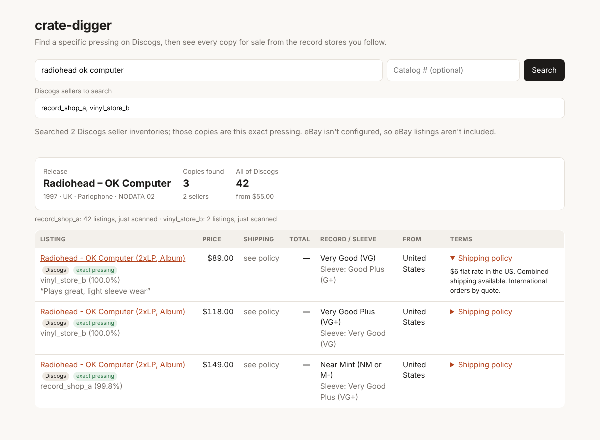

# crate-digger

Find copies of a **specific vinyl pressing** for sale at the record stores you follow, with price, media and sleeve condition, and shipping terms for each copy.

crate-digger runs two ways from the same core:

- **MCP server**: tools an LLM (Claude Desktop, Claude Code, or any MCP client) can call, e.g. *"Find me an original UK pressing of OK Computer under $150 and show me the cheapest one with returns."*
- **Web UI**: a small local page. Search for a record, pick the exact pressing, and get a sortable table of copies.



## How it works

```
 search_releases ──► Discogs database ──► exact pressing (release_id)
                                                   │
 find_copies ──────────────────────────────────────┤
                                                   ├─► Discogs marketplace stats (count, lowest price)
                                                   ├─► chosen sellers' public inventories
                                                   │     1. scan each inventory (100 listings/request, cached on disk)
                                                   │     2. keep listings of this exact release
                                                   │     3. fetch each match: seller rating + shipping policy
                                                   └─► eBay Browse API (optional, if keys are set)
```

### The API constraint, and the workaround

The Discogs API has release data and aggregate stats, but **no endpoint that lists every copy for sale of a release**. That list only exists on discogs.com, and scraping it breaks Discogs' terms of use.

What the API *does* expose is each seller's public inventory, with price, media and sleeve condition, ships-from country and a link to the seller's shipping policy. So crate-digger searches the sellers you choose (your favorite record stores, say) for the exact release:

- **Exact pressings only.** Inventory listings are tied to a Discogs release ID, so there's no fuzzy matching.
- **Rate-limit aware.** Requests are spaced to stay under Discogs' 60/minute limit, and 429 responses are retried with backoff.
- **Cached.** A large store can have tens of thousands of listings, so a full scan can take a few minutes. Scans are saved to disk and reused for 12 hours (configurable), so later searches across any record are instant.
- **Resilient.** An unknown seller or a failed refresh is reported per seller and doesn't stop the search. A stale cache is used if a refresh fails.

eBay's Browse API can add listings from eBay when you have keys (barcode search first, then artist + title). It's optional.

## Setup

```bash
git clone https://github.com/<you>/crate-digger && cd crate-digger
python -m venv .venv && source .venv/bin/activate
pip install -e ".[dev]"
cp .env.example .env   # then fill in your keys
```

| Setting | What it is |
|---|---|
| `DISCOGS_TOKEN` | **Required.** discogs.com → Settings → Developers → *Generate new token* |
| `DISCOGS_SELLERS` | Default sellers to search, comma-separated Discogs usernames. You can also pass sellers per search. |
| `INVENTORY_TTL_HOURS`, `MAX_INVENTORY_PAGES`, `CACHE_DIR` | Cache lifetime (default 12h), scan cap (default 100 pages = 10,000 listings per seller), cache location |
| `EBAY_CLIENT_ID`, `EBAY_CLIENT_SECRET` | Optional. developer.ebay.com → *Production* keyset |

## Run the web UI

```bash
crate-digger-web          # http://127.0.0.1:8000
```

Enter seller usernames in the page (they're remembered in your browser), search for a record, and pick the pressing.

JSON endpoints are also available: `GET /api/releases?q=...&catno=...` and `GET /api/releases/{id}/copies?sellers=a,b&max_price=...&refresh=false`. Interactive docs are at `/docs`.

## Use as an MCP server

Add to your MCP client config (for Claude Desktop, `claude_desktop_config.json`):

```json
{
  "mcpServers": {
    "crate-digger": {
      "command": "/absolute/path/to/crate-digger/.venv/bin/crate-digger-mcp",
      "env": {
        "DISCOGS_TOKEN": "...",
        "DISCOGS_SELLERS": "store_one,store_two"
      }
    }
  }
}
```

For Claude Code: `claude mcp add crate-digger -- /absolute/path/.venv/bin/crate-digger-mcp`. Credentials are read from `.env` in the working directory or from the environment.

### Tools

| Tool | What it does |
|---|---|
| `search_releases(query, artist, title, catno, barcode)` | Find candidate pressings on Discogs |
| `get_market_overview(release_id)` | Release details + Discogs copies-for-sale count and lowest price |
| `find_copies(release_id, sellers, max_price, refresh)` | Copies of the exact pressing from the chosen sellers (and eBay if configured): price, media/sleeve grading, ships-from, seller rating, shipping policy, link |
| `refresh_seller_inventories(sellers)` | Rescan sellers now to warm the cache |
| `get_copy_details(item_id)` | Full details for one listing (Discogs listing id or eBay item id) |

## Tests

```bash
pytest
```

All HTTP calls are mocked with `respx`, so tests run offline with no keys.

## Project layout

```
src/crate_digger/
  discogs.py      Discogs API client (rate limiting, retries, inventories, listings)
  inventory.py    seller inventory scanning + on-disk cache
  ebay.py         eBay Browse API client (optional)
  service.py      matching + orchestration, shared by both front ends
  mcp_server.py   MCP tools
  web.py          FastAPI app
  static/index.html  the UI (no build step)
```

## Limits and ideas

- Only the sellers you choose are searched, not all of Discogs. The page shows the Discogs-wide count and lowest price for comparison.
- Shipping cost depends on the buyer's location, so crate-digger shows each seller's shipping policy rather than a single number.
- Ideas: price-drop alerts for a wantlist, suggesting sellers from a release's past listings, currency conversion, deploying the UI.

## License

MIT
